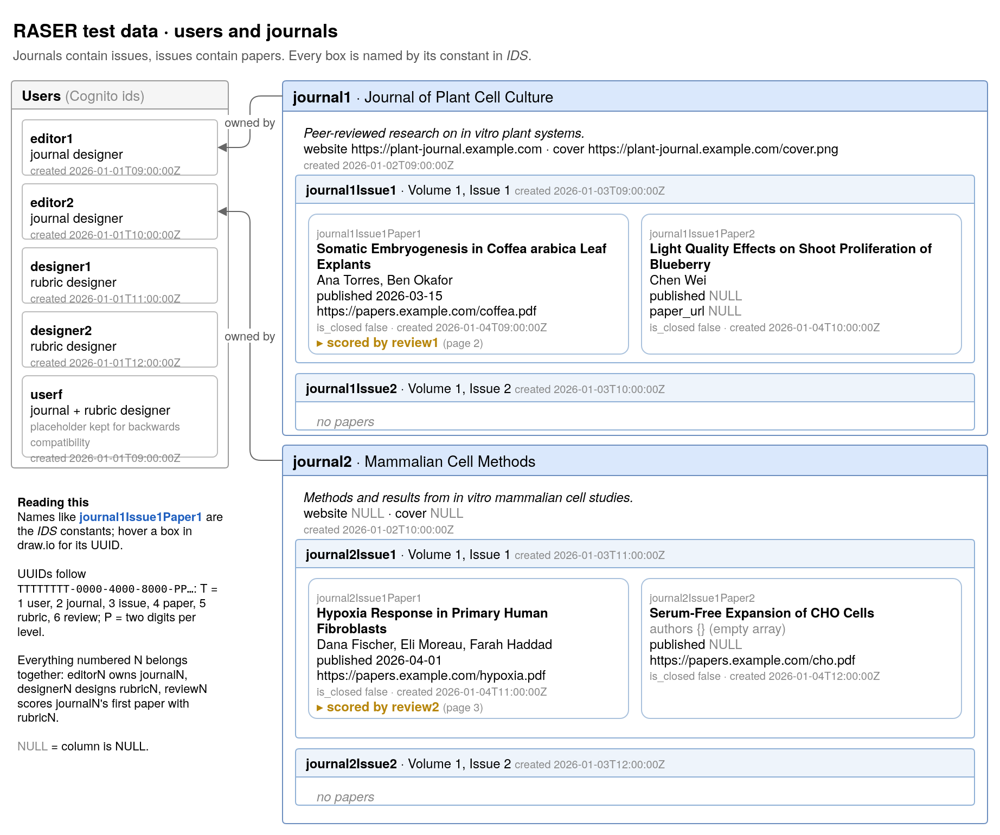
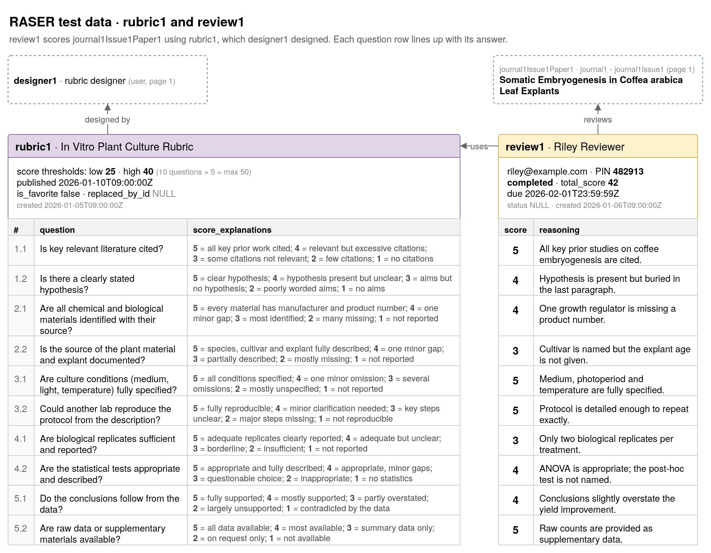
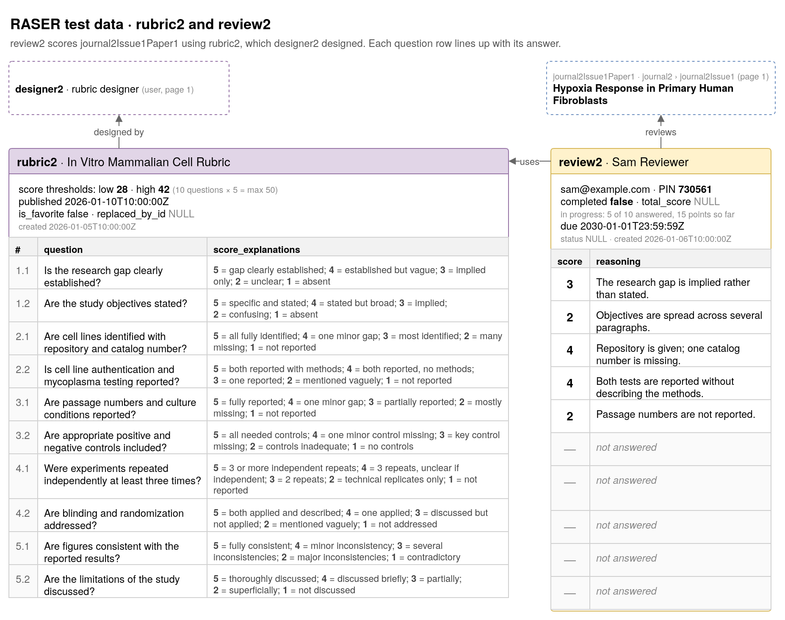

# Lambda Function Database Testing

This document explains how to test lambda functions that perform operations on the
database.

## Test data

> [!NOTE]
> The test data was generated using AI.

The test data can be found in `test/db/test-data.sql`. The data consists of 5 users, one
with id `ffffffff-ffff-ffff-ffff-ffffffffffff` (for backwards compatibility), and 4 other
users, 2 of which are rubric designers and 2 of which are journal editors. There are 2
journals (one for each journal editor), each with 2 issues (vol 1, no. 1 and vol. 1, no.
2), with the first issue in each journal consisting of 2 papers. 



Additionally, there are 2 rubrics (one for each rubric editor), each containing 10 total
questions (2 per section). There are 2 reviews, one completed and one in-progress, that
use the two rubrics on two of the papers. 





The UUIDs of every item follows a particular format:

```
TTTTTTTT-0000-4000-8000-PPPPPPPPPPPP
```

Where:
- `T` is the row type, one digit repeated: 1 user, 2 journal, 3 issue, 4 paper, 5
  rubric, 6 review
- `P` is the position, two digits per level from parent to child (e.g.
  44444444-0000-4000-8000-000000020101 = journal 2, issue 1, paper 1)

Users end in `e1`/`e2` (journal editors) or `d1`/`d2` (rubric designers). The
`-4000-8000-` bit makes every UUID a valid UUID. Everything numbered N belongs together:
editor eN owns journal N, designer dN owns rubric N, and review N scores paper 1 of
journal N's issue 1 using rubric N.

To make writing tests easier, all the UUIDs are declared as constants under `IDS` in
`test/db/describe-with-database.ts` with human-readable names. So instead of writing:

```ts
query("SELECT name FROM journals WHERE owner_id = '11111111-0000-4000-8000-0000000000e1'");
```

You can write:

```ts
query(`SELECT name FROM journals WHERE owner_id = '${IDS.editor1}'`);
```

## Writing tests

Create a file `test/<function-name>.test.ts`, where `<function-name>` is the same name
used for the lambda function file. In that file, import your logic function from your
lambda function file, as well as the `query` helper function (used by your lambda
functions) and the `describeWithDatabase` helper.

```ts
// file: test/<function-name>.test.ts
import { logicFunction } from "../lambda/<category>/<function-name>";
import { query } from "../lambda/db";
import { describeWithDatabase, IDS } from "./db/describe-with-database";

// Replace logicFunction with the name of your function
describeWithDatabase("logicFunction", () => {
  // ...
});
```

The `describeWithDatabase` function is a wrapper around the 
[jest `describe` function](https://jestjs.io/docs/api#describename-fn).
Inside it, you can write test cases using `it` that call your logic function, and those
calls will operate against a mock database with the test data. Additionally, you can call
`query` against the mock database to make sure data was manipulated correctly. Every call
to `it` is independent and starts with the exact same test data.

Here is an example snippet from `test/create-journal.test.ts`:

```ts
// ... (imports)

describeWithDatabase("createJournal", () => {
  it("inserts the journal with just name and returns it", async () => {
    const result = await createJournal({ name: "test1" });
    if ("error" in result) throw new Error(result.error);

    // Make sure return object is correct
    expect(result).toMatchObject({ 
      ownerID: IDS.userf,
      name: "test1", 
      description: null,
      websiteUrl: null,
      coverImageUrl: null,
    });

    // Make sure data was actually inserted
    const { rows } = await query("SELECT name FROM journals WHERE id = $1", [
      result.journalID,
    ]);
    expect(rows).toEqual([{ name: "test1" }]);
  });
});
```

## Running tests

Be sure to `npm install` before attempting to run tests!

Run all test cases:

```sh
npm run test
```

Run all tests within a particular test file:

```ts
npm run test -- tests/<filename>.test.ts
```

Run a specific `it` block by specifying the name of the test (text in the `it` block):

```
npm run test -- -t "name of the test"
```

## How does it work?

**Summary**: The mock database testing is made possible using the 
[Testcontainers](https://testcontainers.com/modules/postgresql/?language=nodejs)
library (PostgreSQL module), which spawns a Docker container running an actual Postgres 
server. On startup, a test database is created, and the schema and test data SQL files are
executed. The database environment variables are overridden to point to this database
instance, which causes all lambda function code to operate on it.

The `globalSetup` function in `test/db/global-setup.ts` file performs all the database
setup whenever you run `npm run test`. It starts the Postgres container, creates an
account in it, and configures SSL certificates so that it allows connections on localhost.
It then creates the template database, runs the SQL files, then locks the locks down the
database so that it cannot change any more (all mock databases are cloned from this
template). After that, it overrides the database environment variables `DB_HOST`,
`DB_PORT`, and `TB_USER` to point to Postgres container.

The `describeWithDatabase` function is a thin wrapper around the jest `describe` function.
It adds two hooks, one that runs before each test (`beforeEach`) and one that runs after
each test (`afterEach`), where a "test" is a call to `it`. Before each test, a new
database is created by cloning the template database (which is faster than re-running all
SQL files every time). The name of the database contains the auto-generated jest worker ID
(see `test/db/setup-env.ts`). After each test, this database is dropped.

