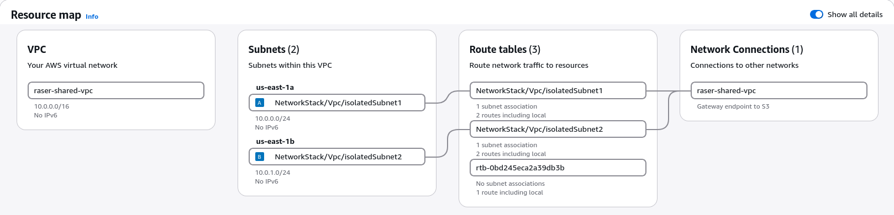
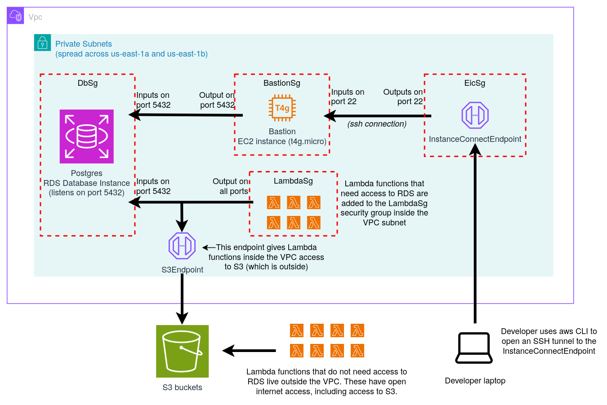

# Virtual Private Cloud (VPC)

> [!NOTE]
> This document was generated mostly using Claude code, though it has been checked for 
> accuracy.

AWS Virtual Private Cloud (VPC) is a service for creating private, isolated networks that
constructs can communicate within. Anything placed inside a VPC (a database, a Lambda
function, an EC2 server) gets a private IP address, and by default can only talk to other
things in the same VPC.

## NetworkStack

The `lib/network-stack.ts` file defines the `NetworkStack` stack, which defines the
following:
- Vpc (`ec2.Vpc`): the VPC instance, named `raser-shared-vpc`
- S3Endpoint: an endpoint for accessing S3 through the VPC
- LambdaSg (`ec2.SecurityGroup`): a security group for Lambda functions that need access
  to the database
- EicSg (`ec2.SecurityGroup`): the security group attached to the Instance Connect
  Endpoint, which developers tunnel through to reach constructs inside the VPC
- BastionSg (`ec2.SecurityGroup`): a security group for the bastion server
- Egress rule allowing connections leaving EicSg going to BastionSg on SSH port (22) 
- Ingress rule allowing connections arriving to BastionSg from EicSg on SSH port (22) 
- Egress rule allowing connections leaving BastionSg going to VPC on DB port (5432)
- InstanceConnectEndpoint (`ec2.CfnInstanceConnectEndpoint`): the "front door" of the VPC.
  It lets a developer who is logged in to AWS open a tunnel from their laptop to a server
  inside the VPC, without that server needing a public IP address
- Bastion (`ec2.Instance`): a small EC2 server that developers SSH into so they can
  forward their connection on to the database. It shuts itself down after 30 minutes
  without any SSH connections, to save money
- Outputs for generated IDs (`VpcId`, `EicEndpointId`, `BastionInstanceId`). These are
  printed after a deploy, and the scripts in `scripts/` read them to find the resources

### Subnets, availability zones, and NAT gateways

A **subnet** is a slice of the VPC's IP addresses. The VPC owns every address from
`10.0.0.0` to `10.0.255.255` (written `10.0.0.0/16`), and each subnet gets a block of 256
addresses from it (`10.0.0.0/24` and `10.0.1.0/24`). Every construct placed in the VPC
lives in one subnet and gets an address from its block.

An **availability zone** (AZ) is a separate data center inside an AWS region. For
example, `us-east-1a` and `us-east-1b` are two AZs in the `us-east-1` region. The VPC
puts one subnet in each of two AZs, because RDS requires a database's subnets to span at
least two AZs. That way it can move the database to the other AZ if one fails.

Both subnets are **private isolated** subnets. That means:
- Nothing in them gets a public IP address, so nothing on the internet can connect to them
- They have no route out to the internet, so nothing inside can connect out either. The
  only routes are "local" (to other addresses in the VPC) and the S3 endpoint

Normally a private subnet that needs to reach the internet would use a **NAT gateway**,
which lets constructs open connections out to the internet while still blocking
connections coming in. We deliberately use none (`natGateways: 0`), because a NAT gateway
is billed by the hour (about $33 per month each) even when nothing uses it. The
trade-off is that Lambdas in the VPC cannot call outside services. The one exception is
S3, which they reach through the S3 gateway endpoint (free). If we later need another AWS
service from inside the VPC, it will need its own endpoint or a NAT gateway.

The resource map below is from the AWS console. It shows the two subnets (one per AZ),
each with its own route table. Both route tables have the "local" route plus a route to
the S3 gateway endpoint. The third route table (`rtb-...`) is the VPC's default main route
table, which AWS creates automatically. No subnet uses it.



### Security groups

A **security group** is like a firewall attached to a construct. It is a list of rules
that say which connections are allowed:
- **Ingress** (inbound) rules say who may open a connection *to* the construct
- **Egress** (outbound) rules say where the construct may open connections *to*

Anything not allowed by a rule is blocked. Security groups are *stateful*: once a
connection is allowed, its replies are automatically allowed back, so you only write a
rule for the side that starts the connection.

A rule's other side can be an IP range (like the whole VPC, `10.0.0.0/16`) or another
security group. "Allow SSH from EicSg" means "allow SSH from anything that has EicSg
attached". This lets us write rules about *roles* (endpoint, bastion, Lambda) instead of
specific IP addresses that change.

## Architecture

There are two ways to reach the database: from Lambda functions, and from a developer's
laptop.

**Lambda functions → database.** Lambdas that need the database are given LambdaSg. It
has no ingress rules (nothing ever needs to connect *to* a Lambda) and allows all egress.
Allowing all egress is safe here because the subnets have no route to the internet, so
the only places a Lambda can actually reach are things in the VPC and S3. The database's
own security group (to be created in `DatabaseStack`) will allow port 5432 in from
LambdaSg.

**Developer laptop → database.** The Instance Connect Endpoint only allows tunnels to SSH
(22) and RDP (3389) ports, so it cannot connect straight to Postgres on 5432. Instead, the
connection takes two hops, and each one is allowed by a matching pair of rules:

1. **Laptop → endpoint → bastion, on port 22 (SSH).** The developer's `aws` CLI opens a
   tunnel to the Instance Connect Endpoint, using their AWS login for authorization. The
   endpoint passes the tunnel on to port 22 on the bastion, and `ssh` on the laptop runs
   through it, so the SSH session is between the laptop and the bastion. This needs:
   - EicSg egress: SSH (22) to BastionSg. This is EicSg's *only* rule
   - BastionSg ingress: SSH (22) from EicSg. This is the bastion's *only* way in

   The endpoint is created with `preserveClientIp: false`. That makes the connection
   arrive at the bastion from the endpoint's own address (which has EicSg) instead of the
   laptop's address, so the "from EicSg" rule matches.
2. **Bastion → database, on port 5432 (Postgres).** Over SSH, the developer asks the
   bastion to forward a port on their laptop (e.g. `localhost:5433`) to the database's
   port 5432. This needs:
   - BastionSg egress: Postgres (5432) to anywhere in the VPC (`10.0.0.0/16`). This is
     the bastion's only way out
   - The database's security group (to be created in `DatabaseStack`) allowing 5432 in
     from BastionSg

The result is that a developer can point a tool like `psql` at `localhost:5433`, and it
behaves as if they were connecting to the database directly. Nothing in the VPC is open
to the internet. Only people who can log in to our AWS account can use the endpoint.

The bastion is the only resource in this stack that costs money by the hour. To keep that
cost low it is the smallest size on the free tier (t4g.micro). Every 5 minutes it checks
whether anyone is connected over SSH, and after 30 idle minutes it shuts itself down. A
shutdown *stops* the instance rather than deleting it, and the scripts start it again
automatically the next time someone needs it.


*Source: [draw.io diagram](https://app.diagrams.net/#G1daPi6rjxN3I5zzp5-_tK03feJzi9pJgx#{%22pageId%22%3A%223lGi3qfcOQ2-hGQlpbAc%22})*

## Testing

### Unit tests

`test/network-stack.test.ts` checks the generated CloudFormation template without
deploying anything or needing AWS credentials. Run it with:

```sh
npx jest test/network-stack.test.ts
```

Along with checking the rules described above, it includes "cost guard" tests. These fail
if the stack ever contains something billed by the hour, such as a NAT gateway, a public
IP, or a bastion larger than t4g.micro.

### Live tunnel test

`scripts/test-tunnel.sh` tests the real, deployed network end to end. Because the
database does not exist yet, it creates a temporary stand-in for one. Run it after
`NetworkStack` is deployed:

```sh
scripts/test-tunnel.sh
```

What the script does:
1. Checks that the tools it needs (`aws`, `ssh`, `curl`) are installed and that the local
   port (5433 by default) is free
2. Reads the `NetworkStack` outputs to find the VPC, endpoint, and bastion
3. Creates a temporary security group that copies what the database's will be: port 5432
   allowed in from BastionSg only
4. Creates a throwaway t4g.micro instance in the VPC that listens on port 5432, which
   makes it look like a database instance. It runs a tiny web server, not Postgres, so it
   can be tested with `curl`. It is placed in the subnet in the *other* AZ from the
   bastion, to test the cross-AZ path the real database might need
5. Starts the bastion if it was stopped, then waits for the stand-in to boot (usually
   2-4 minutes)
6. Opens an SSH connection to the bastion through the Instance Connect Endpoint using the
   `aws` CLI, and forwards `localhost:5433` on your laptop to port 5432 on the stand-in
7. Sends a request to `localhost:5433` and checks that the stand-in's message comes back.
   If it does, the test prints `PASS`

Whether it passes or fails, the script always deletes the stand-in and the temporary
security group when it finishes. If it fails, it prints diagnostics for every hop
(the SSH log, the endpoint and bastion state, and the relevant security group rules).

Options, set as environment variables before the command:

| Variable | Effect |
| --- | --- |
| `LOCAL_PORT=15432` | Use a different local port if 5433 is taken |
| `KEEP=1` | On failure, leave the stand-in running so you can inspect it (the script prints the cleanup command) |
| `REACHABILITY=1` | On failure, also check every hop's security group and network ACL rules (free) |
| `ALLOW_COSTS=1` | Allow paid extras. With `REACHABILITY=1`, this also runs AWS VPC Reachability Analyzer (about $0.10 per path, 2 paths) |

### Helper script `scripts/lib/bastion.sh`

This file is not run directly. Other scripts load it with `source` so they can share the
steps for reaching something private through the endpoint and bastion. It requires the
`AWS_DEFAULT_REGION` environment variable, and it is meant to be shared by
`test-tunnel.sh` and a future `db-connect.sh`. It provides:
- `stack_output <stack> <key>`: reads one output value (like `BastionInstanceId`) from a
  deployed stack
- `port_in_use <port>`: checks whether something on your laptop is already listening on a
  port
- `ensure_bastion_running`: starts the bastion if its idle timer stopped it, and waits
  until it is running
- `start_forward <local-port> <host> <port> <log-file>`: opens the tunnel. It creates a
  one-time SSH key and uses `aws ec2-instance-connect send-ssh-public-key` to give it to
  the bastion (the bastion accepts it for 60 seconds only). It then runs `ssh` through
  `aws ec2-instance-connect open-tunnel` to forward the local port to the host and port.
  A freshly started bastion can take a moment before it accepts SSH, so this retries up
  to 6 times

